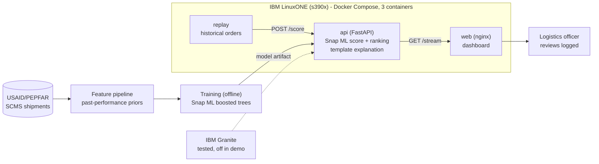

<div align="center">

# V12 Engines
### Order-time delivery-delay early warning for global HIV supply chains

**IBM Z Datathon 2026 · Event code: SSF2026**

<!-- TODO: add a dashboard screenshot or GIF:  -->

</div>

> [!IMPORTANT]
> **This demo is a replay, not a live 2026 feed.** It replays historical orders due 2014–2015 (placed from 26 Feb 2014 onward), one at a time through the scoring API as if placed today. The model was trained on orders due 2010–2013; in deployment it would retrain on current data.

> Ride apps predict arrival to the minute. Life-critical health deliveries rarely have order-time delay prediction.

## Abstract

V12 Engines is an **order-time delivery-delay early-warning engine** for global HIV supply chains (antiretroviral medicines and HIV test kits), running on **IBM LinuxONE (s390x)**. When an order is placed, a **Snap ML** boosted-tree classifier ranks its delay risk against recent orders, and the dashboard shows the runway until the promised delivery date and a historical typical delay range. Template explanations grounded in the model's top drivers say why an order was flagged; IBM Granite was installed and tested on the server; it is off in the demo. Alerts are ranked by risk and order size for logistics officers, whose reviews are logged. **A human always decides.** On orders placed after the training data, it catches 38% of late shipments while flagging 12% of orders, comparable to the best simple rule.

---

## The problem

Late ARVs and test kits risk interrupted HIV treatment. Logistics officers do sense delays through calls and emails with carriers and forwarders, but that signal is manual and inconsistent, and global logistics is disrupted by the unexpected (customs delays, cancelled flights, port congestion). Signals get missed or arrive too late.

## What it does

1. **Ranks delay risk at order time.** Each order gets a risk rank against orders placed in the previous 30 days: the top 10% are **high**, the next 15% **elevated**. The rank is **not a calibrated probability** of being late.
2. **Shows the runway:** "Promised in N days," grouped into long (>120 d), medium (45–120 d), and short (<45 d) tiers. "Order date" is the PO sent date, or the PQ first-sent date when there is no PO.
3. **Shows a typical delay if late:** a historical range (median 13 days, middle half 5–25 days, from late orders due 2010–2013). It is not a per-order prediction.
4. **Ranks alerts** by risk × order size.
5. **Explains each alert** with template text built from the score and the model's top drivers. IBM Granite was installed and tested (about 3–8 s per sentence in our tests) but is **off in the demo**.
6. **Keeps a human in the loop:** officers mark alerts as reviewed, and reviews are logged.
7. **External signals** (port congestion, weather, customs holds) appear as a greyed "future slot": **not in the current data**.

## Architecture



<!-- TODO: add Daniel's final flowchart: docs/architecture.png -->

| Component | Container | Role |
|---|---|---|
| Replay | `replay` | Sends historical orders (due 2014–2015, placed from Feb 2014) one at a time, with only the fields a new order has |
| Scoring API | `api` | FastAPI: builds past-performance features from delivery history, scores with Snap ML, ranks against the last 30 days |
| Dashboard | `web` | nginx serves the Live / Model / Platform pages and forwards `/api` to the scoring API |
| Explanation | in `api` | Template explanations now; IBM Granite tested, off |


### API (served under `/api` by nginx)

| Method | Path | What it does |
|---|---|---|
| GET | `/health` | Status, model version, machine info, measured latency |
| POST | `/score` | Scores one new order and returns its risk rank, runway, drivers and explanation |
| POST | `/deliveries` | Records a delivered order's outcome into the delivery history |
| GET | `/alerts` | Scored alerts, ranked |
| POST | `/alerts/{order_id}/status` | Records an officer's review (acknowledged / actioned / dismissed) |
| GET | `/metrics` | Held-out evaluation figures shown on the Model page |
| GET | `/stream` | Server-sent events: each newly scored order |

## Dashboard views

- **Live:** replayed orders scored as they "arrive"; at-risk shipments ranked by risk × quantity (or risk), with runway badge, risk rank, typical delay, top drivers, and a "why this is flagged" explanation. Shows measured scoring latency.
- **Model:** held-out scorecard (precision-recall curve, confusion matrix, comparison with simpler approaches, how the model was chosen, what drives predictions) with a "read these numbers with care" panel.
- **Platform:** environment evidence captured from the running containers.

## Data

- **Source:** USAID/PEPFAR SCMS shipment data: 10,324 shipments, 2006–2015, 43 countries. HIV treatment drugs (ARVs) and test kits, not vaccines. Mix: ARV 8,550 · HRDT 1,728 · small malaria set 46.
- **Label:** late = delivered date > scheduled date. Overall late rate **11.5%** (train, due 2010–2013: 15.9%; test, due 2014–2015: 14.0%).
- **Key finding:** delays concentrate by fulfillment route: Direct Drop 5.3% vs From RDC 17.2%; From RDC accounts for 78% of late shipments.
- **Split (by promised delivery date):** model trained on orders due **2010–2013**; tested on orders due **2014–2015** (2,545 orders, 356 late).
- **Training era 2010+:** orders due 2006–2009 had a 0–4% late rate and mostly missing decision dates, so they are not used for training.
- **Leakage-safe features:** past-performance priors use only shipments delivered before each order's cutoff.
- **Data source link:** USAID PEPFAR SCMS "Supply Chain Shipment Pricing Data", via [Kaggle](https://www.kaggle.com/datasets/apoorvwatsky/supply-chain-shipment-pricing-data) (file `SCMS_Delivery_History_Dataset_20150929.csv`).

## Results

Headline figures use only orders **placed after the last outcome the model was trained on** (1,734 orders, 164 late, late rate 9.5%). 811 of the 2,545 test orders were placed before 25 Feb 2014, so the model had learned from outcomes that came after they were placed; those are excluded from the headline.

**Orders placed after the training data (live 30-day rule)**

| Approach | Flagged | Late shipments caught | Alerts that were late | PR-AUC | Lift |
|---|---|---|---|---|---|
| **Snap ML boosted trees (final)** | 12.3% | 37.8% | 29.1% | 0.28 | 2.91× |
| Logistic regression | 12.0% | 38.4% | 30.3% | 0.27 | 2.81× |
| Route late-rate lookup | 17.0% | 44.5% | 24.8% | 0.28 | 2.92× |
| Vendor late-rate lookup | 14.1% | 44.5% | 29.9% | 0.30 | 3.14× |
| No skill (random) | n/a | n/a | n/a | 0.09 | 1.00× |

On this view the final model is **comparable to simple baselines**, not clearly better.

**All 2014–2015 orders (late rate 14.0%)**

| Approach | PR-AUC | Lift (PR-AUC vs no skill) |
|---|---|---|
| **Snap ML boosted trees (final)** | 0.36 | 2.55× |
| Logistic regression | 0.26 | 1.85× |
| Route late-rate lookup | 0.29 | 2.08× |
| No skill (random) | 0.14 | 1.00× |

**Error framing:** we aim to catch as many late shipments as possible within a fixed alert budget (top 10% of recent orders), because a missed late shipment (Type II) can mean a clinic stockout, while a false alarm (Type I) costs a follow-up call. Live 30-day rule, orders placed after the training data (shares of 1,734 orders): **Correct 85.4% · Type I 8.7% · Type II 5.9%**. Flagging nothing would be 90.5% correct, because most orders arrive on time, so accuracy is not our headline.

Full details: [`model_card.md`](model_card.md)

## Platform evidence (captured 2026-10-18 04:22 UTC)

| Item | Status |
|---|---|
| s390x architecture, machine type 9175 (IBM z17), 3 vCPUs, 7.8 GB memory, 49.1 GB disk | Verified |
| Snap ML 1.17.2 scoring on s390x | Verified |
| Docker Compose, 3 containers (`api`, `web`, `replay`) | Verified |
| AI accelerator (NNPA) available | Verified (CPU flag present) |
| AI accelerator (NNPA) used by the model | **Not used** (Snap ML default tree format, not optimized) |
| Scoring latency | Median 107.0 ms, p95 114.0 ms (976 orders, measured inside the API) |
| IBM Granite on the server | Off (template explanations) |
| TLS on the scoring API | **Not enabled**: reachable only through the SSH tunnel |
| Quantum-safe cryptography | Not demonstrated (roadmap) |

Data is de-identified, shipment-level only (no patient data). Officer reviews are logged. No secrets, tokens or server IPs are stored in this repo; the dashboard is reached only through an SSH tunnel.

## How to run

<details>
<summary>Deploy on LinuxONE (click to expand)</summary>

```bash
# On the LinuxONE VM (event code SSF2026)
git clone <repo-url> && cd <repo>

# Build and start the three containers (api, web, replay)
docker compose up -d --build        # TODO: confirm command / compose file path

# From your laptop, open an SSH tunnel to the dashboard
ssh -L <local-port>:localhost:<web-port> <user>@<server-ip>   # TODO: ports

# Open http://localhost:<local-port>
```

</details>

## Honest limits

- **Replay, not live:** the demo replays historical orders due 2014–2015; it is not a live 2026 feed.
- The risk score **ranks** orders; it is **not a calibrated probability**.
- The delay range is the **historical** median and middle half; **no days-late regressor shipped** because none beat the median.
- Test years were also viewed during the baseline study, so treat test numbers as **indicative**.
- 98 of the 1,734 headline orders (122 of all 2,545) arrived when fewer than 30 orders had been placed in the previous 30 days; they were ranked against a fixed reference distribution.
- The late rate is **non-stationary** (it swings by year), which is why retraining on recent data matters.
- No dispatch date, in-transit location, or temperature in the data, so no transit-time or cold-chain modeling.
- Impact is an aim, not a measured outcome. The system advises; a human decides.

## Tech stack

IBM LinuxONE (s390x, no GPU) · Snap ML 1.17.2 · scikit-learn (baselines) · FastAPI · Docker Compose · nginx · HTML/JavaScript · IBM Granite (tested, off in the demo)


## Team

**V12 Engines** · IBM Z Datathon 2026 · Event code **SSF2026**

| Member | Role |
|---|---|
| Ethan Ong | Platform: demo VM, Docker containers, SSH tunnel, platform evidence |
| Jihye Noh | Data & preprocessing: data audit, labels, features, time-based split, baselines |
| Vishnu Jegan Babu | IBM Z ML: Snap ML training on s390x, model versioning, accelerator check |
| Aditya Pavuluri | Pipeline: scoring API, score log, replay, generative layer |
| Indra Erdenebat | Research & docs: source research, README, data and model cards, decision log, video script |
| Daniel Baek | Dashboard: Live / Model / Platform views, architecture flowchart, video edit |


