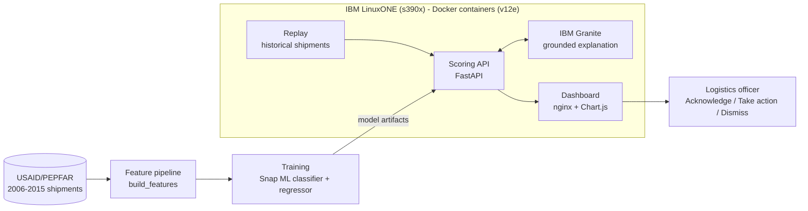

<div align="center">

# 🚀 V12 Engines
### Order-time delivery-delay early warning for global HIV supply chains


**IBM Z Datathon 2026 · Event code: SSF2026**

<!-- TODO: add a dashboard screenshot or short GIF of the Live view (from the final demo) -->
<!--  -->

</div>

> [!IMPORTANT]
> **This demo is a replay of 2006–2015 shipments, not a live 2026 feed.** Models train on earlier shipments and are evaluated on later ones; in deployment they would retrain on current data.

> Ride apps predict arrival to the minute. Life-critical health deliveries still have no order-time prediction.

V12 Engines is an **order-time delivery-delay early-warning engine** for global HIV supply chains (antiretroviral medicines and HIV test kits), running on **IBM LinuxONE (s390x)**. When a shipment is ordered, it predicts the **probability it will be late** and **how many days late**, explains the alert in plain language, and recommends an action. **A logistics officer makes the final call.**

---

## The problem

Late ARVs and test kits risk interrupted HIV treatment. Logistics officers do sense delays through calls and emails with carriers and forwarders, but that signal is manual and inconsistent, and global logistics is disrupted by the unexpected (customs delays, cancelled flights, port congestion). Signals get missed or arrive too late. There is no consistent, order-time risk score.

## What it does

1. **Predicts** late probability (classifier) and days late (regressor) at order time.
2. **Tracks runway:** how many days remain until the promised delivery, grouped into long (>120 d), medium (45–120 d), and short (<45 d) tiers.
3. **Ranks** alerts by risk × quantity × product criticality, shorter runway first among ties. Only the top ~10% by risk is surfaced, to limit alert fatigue.
4. **Explains** each alert with IBM Granite, grounded only in the model's top drivers. Output is checked by a validator, and a templated fallback built from the numbers is used if Granite times out or returns invalid output.
5. **Recommends** an action matched to the runway tier.
6. **Keeps a human in the loop:** Acknowledge / Take action / Dismiss, with a "Reviewed by [officer] · time" log that serves as the audit trail.

## Architecture



<!-- TODO: replace or supplement with Daniel's final one-page flowchart: docs/architecture.png -->

| Component | Folder | Role |
|---|---|---|
| Feature pipeline | `src/features/` | `build_features(df)`: one transform shared by training and serving (no train/serve skew) |
| Training | `src/training/` | Logistic Regression baseline, Snap ML boosted-tree classifier + regressor |
| Scoring API | `src/api/` | FastAPI: `POST /score`, `GET /alerts`, `GET /stream` (SSE), `GET /metrics`, `GET /health` |
| Replay | `src/replay/` | Streams historical shipments into `/score` to simulate live order flow |
| Explanation layer | `src/genai/` | IBM Granite (structured JSON), output validator, templated fallback |
| Dashboard | `src/web/` | HTML + Chart.js: Live, Model, Platform views, served by nginx |

All services run as Docker containers (`scoring-api`, `genai`, `replay`, `web`) on a single LinuxONE VM. nginx forwards `/api/*` to the scoring API (one address, no CORS).

## Dashboard views

- **Live:** replayed shipments scored as they "arrive"; alert cards show probability, days late, runway badge (redder as runway shrinks), top drivers, explanation, recommended action, and the human-in-the-loop buttons.
- **Model:** one time-split scorecard (PR curve, confusion matrix, feature importance, baseline comparison) plus the Correct / Type I / Type II error breakdown.
- **Platform:** environment evidence (`lscpu`, `docker ps`, machine type, NNPA). Items not yet verified are marked "To confirm".

## Data

- **Source:** USAID/PEPFAR SCMS shipment data: 10,324 shipments, 2006–2015, 43 countries. HIV treatment drugs (ARVs) and test kits, not vaccines. Mix: ARV 8,550 · HRDT 1,728 · small malaria set 46.
- **Label:** late = delivered date > scheduled date. Overall late rate **11.5%** (train 10.7%, test 14.0%).
- **Key finding:** delays concentrate by fulfillment route: Direct Drop 5.3% vs From RDC 17.2%; From RDC accounts for 78% of all late shipments.
- **Split (chronological, no shuffling):** train ≤ 2013 (7,779 rows, 830 late) / test 2014–2015 (2,545 rows, 356 late).
- **Leakage-safe features:** `prior_late_rate_*` uses only shipments delivered before each row's cutoff (365-day window, smoothed with M = 20).
- **Data source link:** _TODO: add SCMS dataset URL_

## Results

> Numbers below come directly from the model's `/metrics` output on the 2014–2015 test split. **Fill in only after the final training run; do not estimate.**

| Metric (test 2014–2015) | No skill | Baseline: class-weighted LR | Baseline: route lookup | Snap ML classifier |
|---|---|---|---|---|
| PR-AUC | 0.140 (= test late rate) | 0.163 | 0.297 | _TBD_ |
| Recall at operating threshold | n/a | 0.118 | 0.711 | _TBD_ |
| Precision at operating threshold | n/a | 0.113 | 0.299 | _TBD_ |
| Share of shipments flagged | n/a | 14.7% | 33.2% | _TBD_ |
| Recall in top 10% by predicted risk | 0.100 | 0.020 | 0.229 | _TBD_ |

Baseline figures are from `baseline_report.json` (run Oct 17). The route-lookup baseline scores each shipment by its fulfillment route's prior late rate. Its high recall comes from flagging a third of all shipments, so compare models at the same flagged share (top 10%) rather than at their own thresholds.
Days-late regressor MAE: _TBD_ days (an estimate, not a guarantee).

**Error framing:** we minimize errors rather than maximize accuracy. Type II (predicted on time, actually late) is the costliest, because it is a missed warning, so we favor recall. Type I (false alarm) drives alert fatigue.

| Model | Correct | Type I (false alarm) | Type II (missed late) |
|---|---|---|---|
| Baseline: class-weighted LR | 74.7% | 13.0% | 12.3% |
| Baseline: route lookup | 72.7% | 23.3% | 4.1% |
| Snap ML classifier | _TBD %_ | _TBD %_ | _TBD %_ |

Full details: [`docs/model_card.md`](docs/model_card.md).

## How to run

> _Pending: confirm exact commands with Ethan (Platform) and Adi (Pipeline); see their runbooks in `docs/`._

<details>
<summary>Deploy on LinuxONE (click to expand)</summary>

```bash
# 1. On the LinuxONE VM (event code SSF2026, "-datathon" image, "AI Lab" flavor)
git clone <repo-url> && cd <repo>

# 2. Build and start the Docker containers (scoring-api, genai, replay, web)
#    TODO: replace with the real start command (e.g. a compose file or script path)
./deploy/start.sh

# 3. From your laptop, open an SSH tunnel to the dashboard
ssh -L 8080:localhost:8080 <user>@<server-ip>

# 4. Open http://localhost:8080
```

Data, models, and state live under `/srv/v12e/{data,models,state}`; models are mounted read-only into containers.

</details>

## Security (IBM Z)

We use the platform's security rather than building our own. Status reflects what we actually enabled:

| Item | Status |
|---|---|
| TLS on the scoring API | _Verified / To confirm_ |
| Isolated container (Docker) | _Verified / To confirm_ |
| IBM Z pervasive encryption | _To confirm_ |
| Quantum-safe cryptography | Not demonstrated (roadmap) |

Data is de-identified, shipment-level only (no patient data). The human-in-the-loop log serves as the audit trail.

## Honest limits

- **Replay, not live:** the demo replays 2006–2015 shipments; it is not a live 2026 feed.
- The late rate is **non-stationary** (it swings by year), which is why retraining on recent data matters.
- Predicted days late is an **estimate**, not a guarantee. Predictions are probabilistic.
- The dataset has no dispatch date, in-transit location, or temperature, so we do not model transit time or cold chain.
- Package weight is excluded because it is not known at order time.
- Impact is an aim and a proxy, not a measured outcome. The system advises; a human decides.
- External signals (e.g. port congestion, weather, customs) are a planned future slot and are **not in the current data**.

## Tech stack

IBM LinuxONE (s390x, no GPU) · Snap ML · scikit-learn (baseline) · IBM Granite · FastAPI · Docker · nginx · HTML + Chart.js

## Documentation

| Doc | Path |
|---|---|
| Model / decision card | [`docs/model_card.md`](docs/model_card.md) |
| Platform evidence | `docs/evidence/` |
| Deployment runbook | _TODO: add path_ |
| Demo video script | _TODO: add path_ |

## Open-source and data links

- SCMS / PEPFAR dataset: _TODO_
- Snap ML: _TODO_
- IBM Granite: _TODO_
- FastAPI: _TODO_
- Chart.js: _TODO_

## Team

**V12 Engines** · IBM Z Datathon 2026 · Event code **SSF2026**

| Member | Role |
|---|---|
| Ethan | Platform: demo VM, Docker containers, SSH tunnel, platform evidence |
| Jihye | Data & preprocessing: data audit, labels, features, time-based split, baselines |
| Vishnu | IBM Z ML: Snap ML training on s390x, model versioning, accelerator check |
| Adi | Pipeline: scoring API, score log, replay, generative layer |
| Indra | Research & docs: source research, README, data and model cards, decision log, video script |
| Daniel | Dashboard: Live / Model / Platform views, architecture flowchart, video edit |

| Member | Role |
|---|---|
| Ethan Ong | Platform: demo VM, Docker containers, SSH tunnel, platform evidence |
| Jihye Noh | Data & preprocessing: data audit, labels, features, time-based split, baselines |
| Vishnu Jegan Babu | IBM Z ML: Snap ML training on s390x, model versioning, accelerator check |
| Aditya Venkata Pavuluri | Pipeline: scoring API, score log, replay, generative layer |
| Indra Erdenebat | Research & docs: source research, README, data and model cards, decision log, video script |
| Jongmin (Daniel) Baek | Dashboard: Live / Model / Platform views, architecture flowchart, video edit |
🚀
